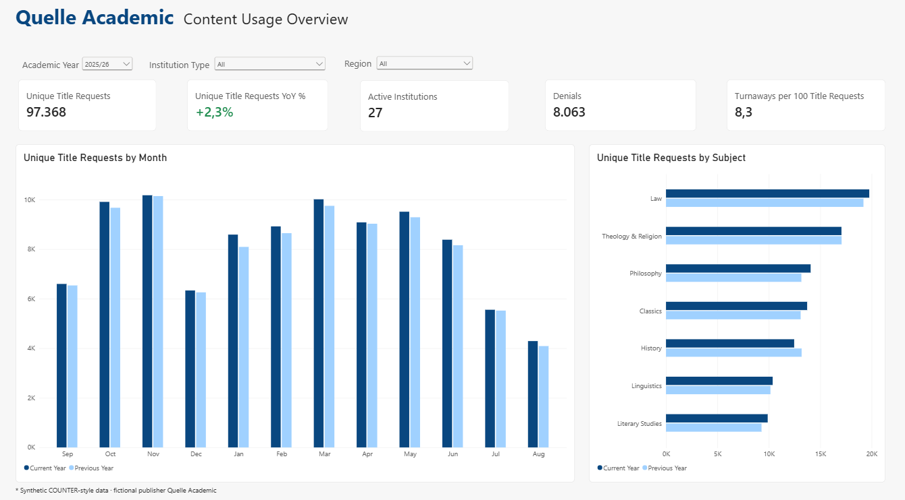
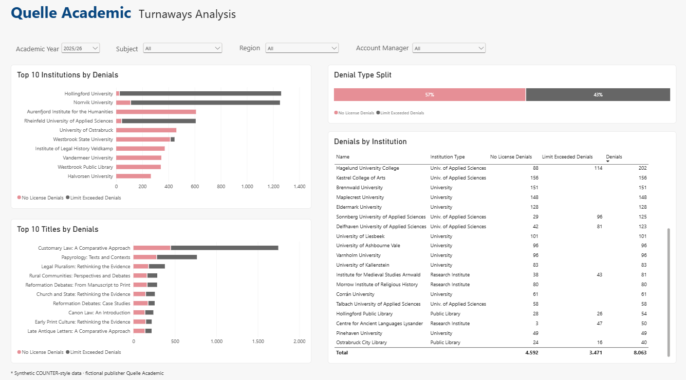
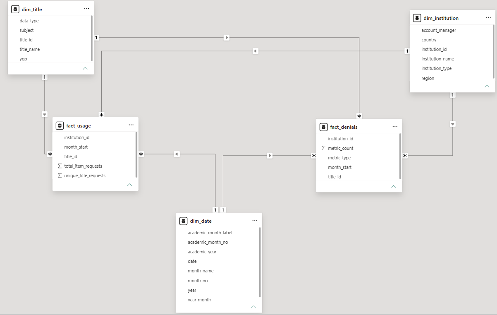

# Quelle Academic – Content Usage Dashboard (Power BI)

A two-page Power BI demo for a fictional scholarly book publisher. It shows Sales and Account Managers how institutional customers use the content and where they are being turned away, based on COUNTER Release 5.1 book metrics.




## Business questions

**Page 1 – Content usage overview**
- Is usage growing or declining compared with the previous academic year?
- How many institutions are actively using the content?
- Which subjects drive usage, and how many access attempts are denied?

**Page 2 – Turnaways analysis**
- Which institutions and titles generate the most denials?
- Is it *No_License* (content not licensed → offer the title or package) or *Limit_Exceeded* (simultaneous-user limit reached → offer more users)?

## Data model



| Table | Grain | Content |
|---|---|---|
| `fact_usage` | month × institution × title | Total_Item_Requests, Unique_Title_Requests (COUNTER TR_B1, Controlled content) |
| `fact_denials` | month × institution × title × denial type | No_License, Limit_Exceeded (COUNTER TR_B2) |
| `dim_date` | day | Calendar 2024–2026 with academic year (Sep–Aug) |
| `dim_institution` | institution | Type, country, region, account manager |
| `dim_title` | title | Subject, year of publication |

All measures are stored in a dedicated `_Measures` table.

## Key measures

| Measure | Definition |
|---|---|
| Unique Title Requests | Sum of COUNTER Unique_Title_Requests (headline usage metric for books) |
| Unique Title Requests YoY % | Change vs the same period of the previous academic year |
| Active Institutions | Institutions with at least one Unique Title Request |
| Denials, No License Denials, Limit Exceeded Denials | Sum of COUNTER access denials, total and by type |
| No License Share % | Share of No_License in all denials |
| Turnaways per 100 Title Requests | Derived indicator, **not** a COUNTER metric |

## About the data and scope

- All data is synthetic, generated with a Python script. The publisher, institutions, titles and people are fictional. *Quelle* is German for "source".
- Simplified scope: books only (no journals or reference works), Controlled content only, monthly data for two academic years (Sep 2024 – Aug 2026), no revenue or order data.
- Generation rules: academic seasonality, modest growth with a few declining institutions, a small number of popular titles driving most usage, unique title requests never above total item requests, and a simple licence model (a title is either licensed or not; only user-limited licences produce Limit_Exceeded).
- The data contains designed patterns (user-limit pressure, unmet demand in specific subjects, prospects with No_License only, declining customers) so the analysis has something to find.
- Report figures were reconciled against independently computed values: [`data/expected_values.md`](data/expected_values.md).

## Repository structure

```
report/   Power BI project (PBIP: .pbip, .Report, .SemanticModel with TMDL)
data/     CSV source files and expected values
docs/     Screenshots, star schema, report theme
```

## How to open

1. Clone the repository.
2. Open `report/Quelle Academic Content Usage.pbip` in Power BI Desktop.
3. Go to Home → Transform data → Edit parameters and set `DataFolder` to the full path of this repo's `data/` folder, including the trailing backslash (e.g. `C:\repos\academic_publishing_COUNTER\data\`).
4. Refresh.
